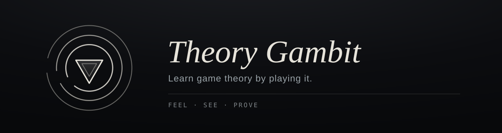

 

 

**Theory Gambit** is a mobile first game for every game theory in [The Gambit](https://hassanireza.github.io/gambit), a field guide to strategy. 118 slots, ordered easy to hard, one short game for each idea.

Every game teaches in three beats, about 60 to 90 seconds in all:

- **Feel.** You play first, with no explanation, and collect evidence with your own hands.
- **See.** The structure behind what you just did is revealed, built from your own moves.
- **Prove.** You apply the idea to a case you have not met. Only passing this marks a theory as understood.

No tutorials, no scores, no menus inside a game. Black and white, dark and light, installable on the iPhone home screen.

**Play:** [theorygambit.github.io](https://theorygambit.github.io/)  ·  **Source:** [theorygambit.github.io repository](https://github.com/theorygambit/theorygambit.github.io)

React · TypeScript · Vite · Canvas 2D. Type is Cormorant Garamond, Jost and JetBrains Mono.
